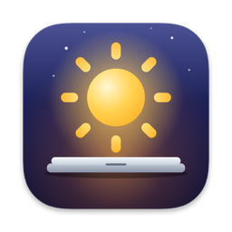

<p align="center"></p>

# Vigil

**Keep your Mac running with the lid closed, for exactly as long as something needs it.**

That something might be a Claude Code agent mid-task, a Blender render, or a multi-hour upload.
When the last job finishes, the Mac goes back to sleeping normally, even inside your bag.

Vigil is a small menu-bar app plus a `vigil` command. It's one native Swift binary of about
1 MB and uses about 12 MB of memory. It's event-driven, with no polling, so it sits at 0% CPU at
rest.

- **Requires** an Apple Silicon Mac on macOS 27 or later (that's what it's built and tested on),
  and an admin password once, during install.

## Install

```bash
curl -fsSL https://raw.githubusercontent.com/THRAUR/vigil/main/get.sh | bash
```

This downloads the latest release (no Xcode needed) and runs its `install.sh`, which does the
following:

- Copies `Vigil.app` to `~/Applications`, and links the `vigil` command into
  `/opt/homebrew/bin` (or `/usr/local/bin`) if one of those folders exists and is writable.
- Asks for your password **once**, to install two root-owned files:
  - `/etc/sudoers.d/vigil`, which allows exactly
    `<you> ALL=(root) NOPASSWD: /usr/bin/pmset -a disablesleep 0, /usr/bin/pmset -a disablesleep 1`.
    sudo matches the arguments exactly, so no other `pmset` call is allowed.
  - `/Library/LaunchDaemons/local.vigil.bootreset.plist`, which runs `pmset -a disablesleep 0`
    at every boot.
- Starts the watchdog and the app (and sets the app to launch at login), then runs `vigil doctor`.

From source instead (needs Xcode or the Command Line Tools with Swift 6):

```bash
git clone https://github.com/THRAUR/vigil && cd vigil && ./install.sh
```

To uninstall (asks for sudo once; add `--purge` to also delete settings and logs):

```bash
~/Applications/Vigil.app/Contents/Resources/uninstall.sh
```

## Use

The menu bar shows a ☾ moon while the Mac sleeps normally and a ☀︎ sun while Vigil keeps it
awake. The sun gets a small battery badge on battery. A thermometer, battery or pause icon means
something wants the Mac awake but a safety rule paused it. ⚠︎ means the flag can't be set; the
menu says why.

From the menu you can:
- toggle **Keep Awake**, start a **Keep Awake For** timer (30 min to 4 h), or **Let It Sleep**
  (release everything);
- see every hold, with its reason and time left, and release any one of them;
- change the safety settings and launch at login, and open the log.

```bash
vigil status                         # what's holding the Mac awake, and the flag as the system reports it
vigil on / vigil off                 # Keep Awake / Let It Sleep
vigil hold --for 2h --reason render  # a timed hold
vigil hold --pid 4242 --for 6h       # until that process exits (at most 6 h)
vigil run -- blender -b scene.blend -a        # hold exactly while a command runs
vigil release ID | --all             # release one hold (by id or unique prefix), or all
vigil config                         # list settings; vigil config battery-floor 25 changes one
vigil doctor                         # check every piece of the install, changes nothing
vigil log -f                         # follow the log
```

### Claude Code

Claude Code support is optional, and it never changes your settings without asking:

```bash
vigil install-hooks      # shows the ~/.claude/settings.json diff, asks, keeps a backup
vigil uninstall-hooks
```

Each Claude Code session then holds the Mac awake while it works:

| Hook event | What Vigil does |
|---|---|
| UserPromptSubmit | acquires the session's hold |
| PreToolUse | refreshes the hold (it re-creates it if the agent had dropped it, but never if *you* released it) |
| Stop | releases the hold, unless the turn left background tasks running; then it keeps holding until they report back |
| StopFailure, SessionEnd, idle or permission notifications | release the hold (Stop doesn't fire when you press Esc) |

A crashed session also lets go: each hold watches its `claude` process. Holds with no activity for
2 hours are released. Hooks are silent, take about 10 ms, and never start the app, so quitting
Vigil means off.

## Safety

These rules pause the flag even while holds exist. The holds stay, and the flag comes back when
the condition clears.

| Rule | Default |
|---|---|
| Battery floor | on battery, sleep at or below 20% (Off, or 10 to 50%) |
| Thermal cutoff | sleep at `serious` (or only at `critical`); resume after 2 minutes cooler. MacBook Airs are fanless. |
| Low Power Mode | pause while it's on |
| Only while plugged in | off |
| Display off when the lid closes | on (skipped with an external display) |
| Sleep when holds end with the lid closed | on: `pmset sleepnow` after 10 s, because other apps' assertions can otherwise keep a closed Mac awake. This is verified to be necessary. |
| Mac mini mode | off: stay awake whenever plugged in |

**Never stuck on:**
- A watchdog LaunchAgent clears the flag the moment the app dies, or after 90 s without a heartbeat if it hangs.
- The app clears it on quit, on SIGTERM, SIGINT and SIGHUP, and when it starts with nothing to hold.
- A crash handler clears it too.
- The boot-time reset clears it at every boot.

**Recovery:** if the Mac ever refuses to sleep, run `sudo pmset -a disablesleep 0`. Vigil treats
that as "Let it sleep" and doesn't fight it. A reboot also clears it. macOS saves the flag in
`/Library/Preferences/com.apple.PowerManagement.plist`, so it is the boot-time reset that makes the reboot work.

## How it works

On Apple Silicon, only the kernel's `SleepDisabled` flag survives closing the lid; `caffeinate`
and power assertions don't. Vigil sets it with `sudo -n pmset -a disablesleep 1|0` and reads it
back after every write, from both the kernel (IOPMrootDomain) and `pmset -g`. The menu always
shows what the system reports, not what Vigil intended.

**Holds.** The flag is on while at least one hold exists. Holds are keyed, so acquiring the same
key again refreshes it rather than stacking.

| Kind | Made by | Ends |
|---|---|---|
| manual | Keep Awake, `vigil on` | when you release it |
| timed | timers, `hold --for` | at its deadline (wall clock, so time asleep counts) |
| process | `hold --pid`, `run` | when the process exits |
| session | Claude Code hooks, `acquire --session` | on release, when its process exits, or after 2 h idle |

**Events, not polling.** The app reacts to:
- IOKit power-source and lid notifications;
- NSWorkspace sleep and wake;
- thermal and Low Power Mode notifications;
- process-exit events.

The only clocks are a 30 s heartbeat and a timer for the next deadline. After a crash, launchd
restarts the app, and it restores holds from the same boot.

**Files:**
- `~/Library/Application Support/Vigil/` holds the state, the heartbeat and the socket.
- `~/Library/Logs/Vigil/vigil.log` records every change.
- `~/Library/LaunchAgents/local.vigil*.plist` are the two LaunchAgents.

## Develop

```bash
make test       # 68 unit tests: holds, refcounting, safety hysteresis, watchdog, hook policy, settings.json edits
make app        # build.noindex/Vigil.app (ad-hoc signed; .noindex keeps it out of Spotlight)
make release    # dist/Vigil.zip, the release asset that get.sh installs
./install.sh --update   # reinstall the app without touching the privileged parts (no sudo)
```

Test mode runs the app, watchdog, CLI and hooks without sudo or the real flag:

```bash
export VIGIL_HOME=/tmp/vt VIGIL_FAKE_FLAG=/tmp/vt/flag VIGIL_CLAUDE_SETTINGS=/tmp/vt/settings.json
```

The `VIGIL_HOME` path must be short, because Unix socket paths are limited to 104 bytes. To check
lid behaviour on real hardware, run `scripts/lid-test.sh`, close the lid, and read
`~/vigil-lid-test.log` afterwards.

Verified on a MacBook Air M3 running macOS 27.0.1:
- **Lid closed:** 11 minutes on battery with a logger writing every 10 s. The Mac slept 15 s
  after the hold ended.
- **Watchdog:** after `kill -9` of the app it cleared the flag in 0.16 s, and it caught a frozen
  app at 92 s.
- **Timed hold:** ended on time.
- **Claude Code hooks:** a turn acquired its hold and released it.

## Credits

Vigil combines ideas from four MIT-licensed projects:

- [Adrafinil](https://github.com/kageroumado/adrafinil): activity-scoped, refcounted holds and agent hooks.
- [Lidless](https://github.com/nghialuong/Lidless): heartbeat watchdog, pause when hot, low-battery cutoff.
- [Mac mini Mode](https://github.com/Pama-Lee/MacMiniMode): awake on AC, display off with the lid closed, health check.
- [Sleepless](https://github.com/Aboudjem/Sleepless): a sudoers rule limited to two exact commands.

MIT licensed; see [LICENSE](LICENSE).
